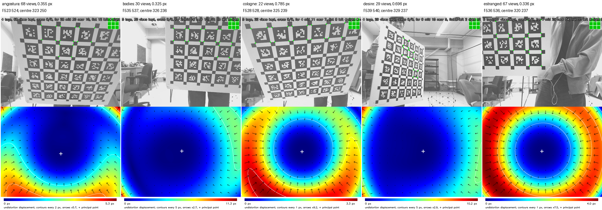

# Camera calibrations

One file per camera model and image size, named `<model>_<width>x<height>.yaml`. From
the repository root, with the car set up (`ros2 run camslab car setup`),

    ros2 run camslab car calibrate --name <model>_<width>x<height>

calibrates a car's camera from its image topic with the lab's AprilTag board (6 x 6
AprilTag 36h11 tags of 8.8 cm, 2.64 cm apart), writes the file here and sets `camera` in
`config/survey.yaml`. Commit new files so that every car with the same camera uses them.
See `docs/hardware-survey.md`.

The five cars calibrated on 2026-11-05 and 06, each with the last board view the
calibration saw and its undistortion map:

| Car | Views | Reprojection error | Focal length | Principal point |
|---|---|---|---|---|
| angostura | 68 | 0.36 px | 523 | 323, 250 |
| bodies | 30 | 0.33 px | 535 | 326, 236 |
| cologne | 22 | 0.79 px | 528 | 325, 239 |
| desire | 29 | 0.70 px | 539 | 329, 237 |
| estranged | 67 | 0.34 px | 536 | 320, 237 |

All five have the same camera module, so the focal lengths and principal points agree to
a few percent; a calibration far from these numbers is wrong, whatever its error.
