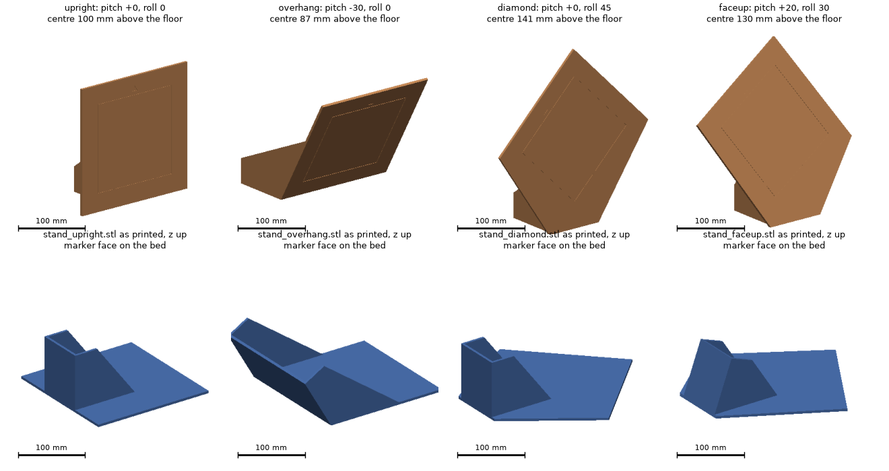

# Marker stands for the fiducial survey

Printable floor stands that hold the 140 mm ArUco markers of
[docs/hardware-survey.md](../../docs/hardware-survey.md) at four fixed orientations, so
that a run sees marker rotations that differ in pitch and roll and not only in yaw. The
markers stay where they are put; yaw is set by turning a stand on the floor.

Each stand is one print with no joints, glue or hardware: the 200 mm marker plate stands
on its own lower edge, with an open tray behind it, a foot on the floor and a side wall at
each edge of the foot running up the back of the plate. The tray is open at the top and
the back, so a weight can rest on the foot. The pitch is the angle the tray is cut at,
the roll is the angle the marker is turned on the plate. A rolled plate stands on a
corner, so it is extended down to the floor across the tray's width and the face is one
flat surface to the floor. The overhang stand leans toward
the car, so its tray is the full width of the plate and it needs a weight on the foot
(below); nothing stands on the floor in front of the face.

| Stand | Pitch | Roll | Marker centre above the floor | Highest point |
|---|---|---|---|---|
| upright | 0 | 0 | 0.10 m | 0.20 m |
| overhang | 30° face down | 0 | 0.09 m | 0.18 m |
| diamond | 0 | 45° | 0.14 m | 0.28 m |
| faceup | 20° face up | 30° | 0.13 m | 0.26 m |

Pitch tilts the marker normal up (positive) or down; roll turns the marker about its
normal. The heights are nominal: measure each centre once the stands are set up and put
the values in `marker_height` of `config/survey.yaml`. For a marker higher up, stand a
print on a table or a bin and measure again; the stands do not need to be on the floor.

All four are level with the Yahboom R2 camera, which sits 0.12 m above the floor and
looks level with a 47° vertical field of view at 640 x 480 (`nominal_fov: 60`). The
floor is in the image from 0.28 m on and the highest point, the diamond's top corner, from
0.38 m, so every stand is whole in the image from 0.38 m to the far side of the mocap
volume. At 1.5 m the camera is 1° off the normal of the upright and the diamond, 20° off
the faceup and 31° off the overhang, all well inside the 60° or so at which ArUco still
decodes.

## Printing

All four print as the STL is oriented: the marker face on the bed, the tray up.

| File | On the bed | Bed | Height | Weight, solid | Weight, 15 % infill |
|---|---|---|---|---|---|
| `stand_upright.stl` | as is | 200 x 200 mm | 94 mm | 296 g | 204 g |
| `stand_overhang.stl` | as is | 200 x 247 mm | 102 mm | 365 g | 257 g |
| `stand_diamond.stl` | turned 45° | 233 x 233 mm | 94 mm | 329 g | 226 g |
| `stand_faceup.stl` | turned 30° | 208 x 244 mm | 89 mm | 314 g | 215 g |

The bed sizes are the smallest box each print fits in when turned on the bed, which
`mounts.py` prints with the turn. All four fit a 256 x 256 mm bed; on a 250 x 210 mm bed
the overhang and the faceup go with their long side along x and the diamond does not fit,
and only the upright fits a 220 x 220 mm bed. No print needs
supports: face down, the foot and the side walls are walls on the plate, leaning by the
pitch (30° on the overhang, 20° on the faceup). The face-down prints give the marker a
flat backing with the bed's finish.

PLA, 0.2 mm layers, three walls and 15 % infill are enough; the plate, the foot and the
side walls are all 4 mm thick, so the prints are mostly skin and infill changes little.
The infill weights assume 1.2 mm of skin on every surface; all four stands are about
900 g of filament.

`mounts.py` also prints how far each stand's centre of mass sits inside its footprint,
the floor slope at which it would tip and the weight on the foot that would put the
centre of mass 15 mm inside. The upright, the diamond and the faceup stand on their own:
15 mm and 9° for the diamond, the least stable. The overhang stand's plate leans 50 mm in
front of its lower edge, so the print alone falls forward; 175 g in the middle of its
foot holds it with the 15 mm margin, so put 200 g or more there, as far back as the
foot goes, before letting go of it. A level floor is enough, but do not lean anything on
a stand.

## Setting up

1. Print `markers.pdf` at 100 % (not "fit to page") and check the 100 mm scale line on
   each page with a ruler. Every page is one 140 mm marker inside a dashed 200 mm cut
   square with a chevron above it: ids 0 to 3, two copies each, on Letter paper.
   `python3 markers.py --ids 0 1 2 --copies 3 --page a4` makes other sets.
2. Cut on the dashed line and glue the square to the plate's face, centred on the
   engraved 140 mm outline, with the printed chevron toward the engraved chevron. The
   square covers the whole face and keeps a 30 mm white quiet zone around the marker; on
   the diamond and faceup stands turn the square with the engraved outline, which is
   already rolled.
3. Stand each print on the floor and turn it to the yaw the run needs. The marker faces
   away from the foot.

## Changing the design

`mounts.py` builds every stand with the manifold3d CSG kernel and writes the STLs:

    pip install manifold3d numpy matplotlib
    python3 mounts.py --preview

The constants at the top set the marker side, plate size and thickness, the tray
dimensions, the skin and infill of the weight estimate and the tipping margin the
counterweight is sized for; `STANDS` lists each stand's pitch and roll, and for the
overhang the full-width tray. The script checks every print for faces that would need
support, prints the marker centre, the highest point, the bed footprint, the weights, the
tipping margins and the counterweight, and renders the preview with a scale bar in every
panel. A new orientation is one more `Stand`; one that leans toward the car gets a
full-width tray, and the table says what to put in it.
